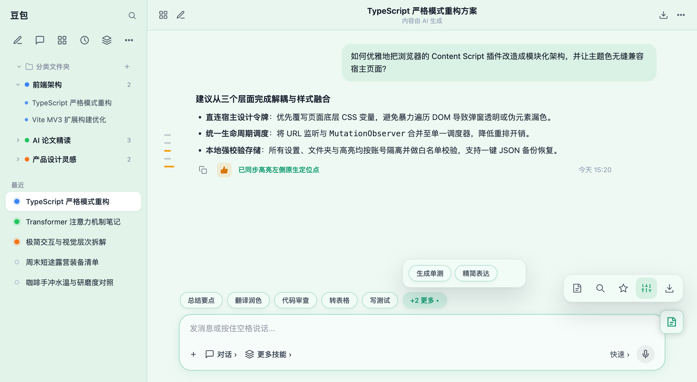
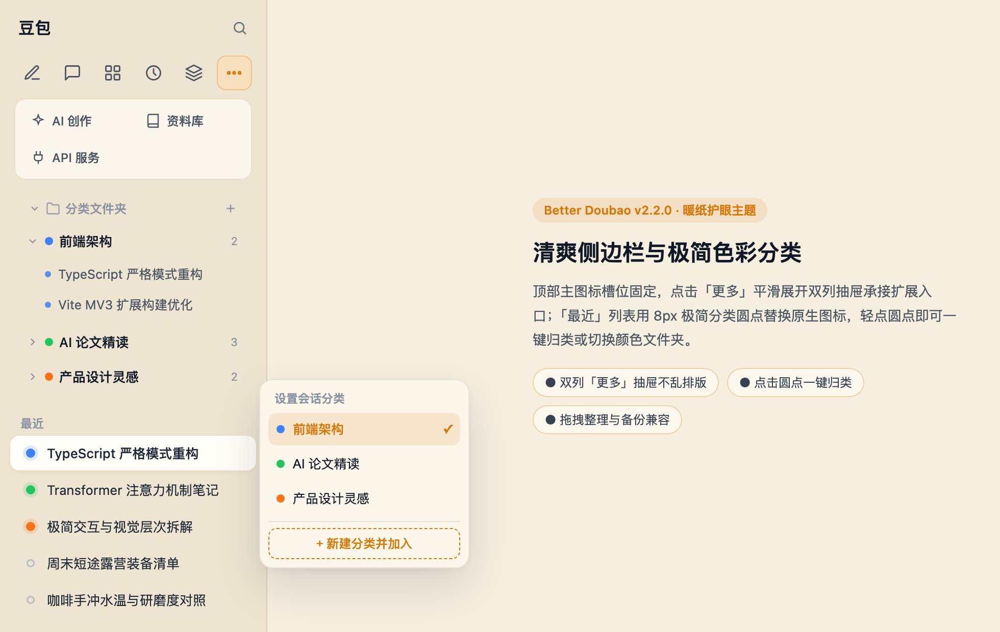
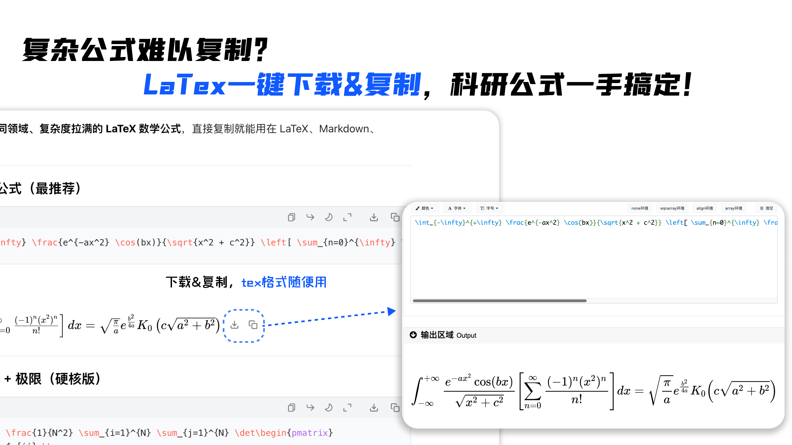

<div align="center">

# Better Doubao

**豆包网页版效率与界面美学增强扩展**

可视化布局定制 · 六套全局配色主题 · 悬浮快捷胶囊 · 分类文件夹与极简圆点 · 六色高亮 · 语料板 · 多格式导出

<br />

[](https://github.com/Rex16200513/Better_Doubao/actions/workflows/ci.yml)
[](https://github.com/Rex16200513/Better_Doubao/releases/latest)
[](https://microsoftedge.microsoft.com/addons/detail/better-doubao/ehkiambnigofgjbodfabknebbmlkblpd?hl=zh-CN)
[](chrome/manifest.json)
[](tsconfig.json)
[](LICENSE)

<br />

[概览](#概览) &nbsp;·&nbsp; [核心功能](#核心功能) &nbsp;·&nbsp; [安装使用](#安装使用) &nbsp;·&nbsp; [项目架构](#项目架构) &nbsp;·&nbsp; [版本记录](#版本记录) &nbsp;·&nbsp; [问题反馈](https://github.com/Rex16200513/Better_Doubao/issues/new/choose)

</div>

<br />

> 已正式上架 [Microsoft Edge 插件商店](https://microsoftedge.microsoft.com/addons/detail/better-doubao/ehkiambnigofgjbodfabknebbmlkblpd?hl=zh-CN)，最新构建包亦可直接从 [GitHub Releases](https://github.com/Rex16200513/Better_Doubao/releases/latest) 获取。项目灵感源于 [gemini-voyager](https://github.com/Nagi-ovo/gemini-voyager)。

---

## 概览

Better Doubao 致力于让豆包网页版更克制、更顺手、更具个性。所有数据均保存在浏览器扩展本地私有存储（`chrome.storage.local`），零后端、不上传任何对话内容。

<br />



<br />

<table>
  <tr>
    <td width="50%" valign="top">
      <strong>可视化布局与配色定制</strong><br />
      在豆包界面原型图上直接点选开关各区域元素，内置六套全局配色主题，直连宿主 CSS 设计令牌无缝同步变色。
    </td>
    <td width="50%" valign="top">
      <strong>悬浮快捷指令胶囊栏</strong><br />
      在输入框上方左对齐悬浮展示常用 Prompt 胶囊，一键填入；超出 5 个自动收纳至 <code>+N 更多</code> 向上弹层。
    </td>
  </tr>
  <tr>
    <td width="50%" valign="top">
      <strong>分类文件夹与极简色彩圆点</strong><br />
      隐藏「最近」列表中杂乱的原生对话图标，替换为 8px 极简分类圆点，点击圆点一键归类或拖拽整理。
    </td>
    <td width="50%" valign="top">
      <strong>侧边栏收纳与双列「更多」抽屉</strong><br />
      顶部固定横排图标收纳高频入口，展开「更多」时下方平滑弹出双列小抽屉，彻底告别布局跳动。
    </td>
  </tr>
  <tr>
    <td width="50%" valign="top">
      <strong>统一毛玻璃工具栏</strong><br />
      集成语料板、对话搜索、六色划词高亮目录与本地 JSON 备份恢复，所有面板统一 316px 可拖动卡片。
    </td>
    <td width="50%" valign="top">
      <strong>多格式导出与 LaTeX 工具</strong><br />
      清爽导出 PDF / TXT / Markdown（修复空白与表格样式），支持数学公式一键复制与 <code>.tex</code> 下载。
    </td>
  </tr>
</table>

---

## 核心功能

### 1. 可视化布局与六套全局配色主题

打开右下角工具栏的「界面与按钮定制」，即可在交互式豆包原型图上完成所见即所得的配置：

- **原型图直点开关**：自由控制顶部图标收纳、分类文件夹与色彩圆点、底部推广区、顶栏导出/下载按钮、输入框精简底栏及单个原生技能按钮的显隐。
- **六套全局配色主题**：提供 **默认纯净 / 靛蓝极客 / 翡翠森系 / 暖纸护眼 / 暮光微紫 / 深邃暗夜**，选中即时预览；直接覆写豆包原生 CSS 变量，画布、欢迎语动画遮罩、圆角输入框与浮层保持完整视觉统一。
- **快捷胶囊管理**：在弹窗内直接增删常用指令，输入框上方自动闭环左对齐，且不压盖原生「更多技能」抽屉。

<br />


<br />

### 2. 侧边栏双列抽屉与极简色彩分类

重构侧边栏信息密度，让高频导航与历史会话各得其所：

- **固定主图标栏 + 双列抽屉**：将「新工作任务 / 新对话 / 工作台 / 定时任务 / 插件·技能·伙伴」收敛为一排紧凑图标，「更多 / 收起」固定在最右侧；展开后在下方平滑呈现双列抽屉承接「AI 创作 / 资料库 / API 服务」。
- **8px 极简色彩圆点**：自动隐藏「最近」列表中每条对话左侧的原生图标，未分类显示淡灰空心圆环，已分类呈现对应文件夹的主题色圆点。
- **一键归类与拖拽整理**：点击任意对话前的圆点即可弹出分类浮层，快速勾选、移除或新建彩色文件夹，同时完整兼容拖拽归类与历史备份数据。

<br />



<br />

### 3. 统一工具栏：语料板、搜索、六色高亮与备份

点击页面右下角可拖动悬浮入口，展开五项常用工具，全部采用统一 `316px` 毛玻璃卡片并支持标题栏拖动与 `Esc` 关闭：

- **语料板**：划词收藏高频片段，跨对话随时勾选并一键插入输入框。
- **对话搜索**：在当前已加载对话中快速定位关键词并展示上下文摘要，支持 `Enter` / `Shift+Enter` 上下跳转。
- **六色划词高亮**：选中文本一键荧光标记（黄 / 绿 / 青 / 粉 / 红 / 灰），支持按颜色筛选、目录内直删与跨对话定位。
- **JSON 备份与恢复**：一键导出当前账号的全部文件夹、归类、语料与高亮记录（上限 10 MB）；导入前自动校验与数量预览，并在私有存储留存恢复前副本。

<br />


<br />


<br />

### 4. 多格式对话导出与 LaTeX 公式

- **多格式清爽导出**：顶部导航栏一键导出 **PDF / TXT / Markdown**，按对话标题命名，自动清洗冗余空白并保留代码块、表格与图片（过滤 base64 占位图）。
- **LaTeX 公式工具**：自动识别内联公式、块级公式与 LaTeX 代码块，悬停即可复制源码或下载 `.tex` 文档。

<br />


<br />



---

## 安装使用

### Edge 插件商店

访问 [Microsoft Edge 插件商店](https://microsoftedge.microsoft.com/addons/detail/better-doubao/ehkiambnigofgjbodfabknebbmlkblpd?hl=zh-CN) 搜索 **Better Doubao** 直接安装（商店版本受审核周期影响，可能略晚于 GitHub Releases）。

### 下载预编译安装包（推荐）

无需 Node.js 环境，下载对应浏览器 ZIP 解压即可加载：

| 浏览器 | 安装包 | 说明 |
| --- | --- | --- |
| Chrome | [Better_Doubao_Chrome_v2.2.2.zip](https://github.com/Rex16200513/Better_Doubao/releases/download/v2.2.2/Better_Doubao_Chrome_v2.2.2.zip) | 在 `chrome://extensions/` 加载解压目录 |
| Edge | [Better_Doubao_Edge_v2.2.2.zip](https://github.com/Rex16200513/Better_Doubao/releases/download/v2.2.2/Better_Doubao_Edge_v2.2.2.zip) | 在 `edge://extensions/` 加载解压目录 |
| 校验和 | [SHA256SUMS_v2.2.2.txt](https://github.com/Rex16200513/Better_Doubao/releases/download/v2.2.2/SHA256SUMS_v2.2.2.txt) | 安装包 SHA-256 完整性校验 |

> 加载步骤：解压 ZIP 到固定目录 → 打开扩展管理页并开启「开发者模式」→ 点击「加载已解压的扩展程序」→ 选择包含 `manifest.json` 的文件夹（安装后请保留该目录）。

### 从源码构建

```bash
npm install
npm run build        # 构建 Chrome (chrome/dist) 与 Edge (edge/dist) 并校验产物
```

常用开发命令：

```bash
npm run dev:chrome   # 监听 Chrome 实时构建
npm run dev:edge     # 监听 Edge 实时构建
npm run typecheck    # TypeScript 严格模式检查
npm test             # 运行回归测试与单元测试
```

---

## 项目架构

- **技术栈**：TypeScript（Strict Mode） · Vite + `@crxjs/vite-plugin` · Manifest V3 · Native CSS Variables
- **数据隐私**：纯前端本地运行，按账号隔离存储在 `chrome.storage.local`，无任何第三方数据上报。
- **持续集成**：GitHub Actions CI（Node 20 / 22 矩阵：`typecheck` + `test` + `build`）与 Tag 自动打包发布流水线。

<details>
<summary>展开查看目录结构</summary>

```text
better-doubao/
├── .github/workflows/
│   ├── ci.yml                  # 类型检查 / 单测 / 双端构建校验
│   └── release.yml             # 自动打包并发布 Chrome / Edge ZIP
├── archive/
│   └── QuickLocator.legacy.ts  # 归档的旧版独立定位器
├── src/
│   ├── core/
│   │   ├── services/           # StorageService / SettingsService / PageLifecycle
│   │   ├── types/              # folder.ts / settings.ts
│   │   └── utils/              # dom.ts / ui.ts
│   ├── features/
│   │   ├── workspace/          # LayoutStudioModal / WorkspaceCustomizer
│   │   ├── sidebar/            # SidebarLauncher（顶部图标栏与双列抽屉）
│   │   ├── folder/             # FolderManager（分类文件夹与极简色彩圆点）
│   │   ├── tools/              # ToolHub（语料板 / 搜索 / 高亮目录 / 备份）
│   │   ├── corpusboard/        # CorpusBoard / TextHighlighter
│   │   ├── export/             # ExportManager（PDF / TXT / Markdown）
│   │   └── latex/              # LatexDownloader
│   ├── pages/
│   │   ├── content/            # 内容脚本入口
│   │   ├── background/         # Manifest V3 Service Worker
│   │   ├── popup/              # 扩展弹窗页
│   │   └── options/            # 扩展功能开关页
│   └── assets/styles/
│       └── content.css
├── tests/                      # 回归测试、单元测试与构建产物校验
├── chrome/                     # Chrome Manifest V3 配置与构建输出
└── edge/                       # Edge Manifest V3 配置与构建输出
```

</details>

---

## 版本记录

### v2.2.2

- **界面与侧边栏稳定性**：修复输入框技能按钮隐藏后无法实时恢复的问题；修复侧边栏快捷入口在豆包 React 重挂载后点击失效的问题；修复跨标签页/设置页保存相互覆盖与 Studio 恢复默认误重置其他模块开关的问题。
- **导出与 LaTeX 质量**：修复 Markdown/TXT 导出内联拆段、代码块与列表缩进损坏、菜单溢出视口、PDF 清洗误删 `<br>` 与角色误判；修复 LaTeX 流式输出截断、`.tex` 未包入数学环境/重复包裹 `\documentclass` 及连续双击复制图标卡死问题。
- **高亮、语料板与安全加固**：修复文本高亮跨消息错贴、多块消息匹配与漂移后移除失败；修复语料板角标卡在 0、SPA 切换未刷新及搜索 Range 越界；修复文件夹跳转开放重定向与选择器注入、IME 回车误提交，并加固损坏存储的备份恢复校验。
- 安装包：[Release v2.2.2](https://github.com/Rex16200513/Better_Doubao/releases/tag/v2.2.2)

### v2.2.1

- 移除容易受豆包虚拟列表 DOM 变动影响的原生定位点点赞标星模块，恢复左侧原生定位点纯粹体验，同时完整保留历史备份数据兼容。
- 重新排版无 Emoji 的清爽版 README，并同步更新高清功能演示截图。
- 安装包：[Release v2.2.1](https://github.com/Rex16200513/Better_Doubao/releases/tag/v2.2.1)

### v2.2.0

- 新增可视化原型图 **界面布局与配色定制工作室** 与 **六套全局配色主题**，直连豆包原生 CSS 设计令牌。
- 新增输入框上方 **悬浮快捷指令胶囊栏**（闭环左对齐，超 5 个自动收纳至 `+N 更多` 弹层）。
- 升级 **分类文件夹与 8px 极简色彩圆点**，替换原生对话图标并支持点击圆点一键归类。
- 升级 **侧边栏「更多」双列抽屉**，展开与收起不再破坏顶部图标顺序。
- 统一毛玻璃工具面板为 `316px` 规范，修复 PDF 导出空白与表格样式问题，并归档旧版独立定位器（豆包已提供官方定位功能）。
- 安装包：[Release v2.2.0](https://github.com/Rex16200513/Better_Doubao/releases/tag/v2.2.0)

<details>
<summary>历史版本（v2.1.0 / v2.0.0）</summary>

#### v2.1.0
- 深色模式主题变量适配、扩展设置页功能开关、六色高亮筛选与列表内直删、非阻塞 Toast / 确认弹窗、PDF 安全清洗与 CI / Release 自动化流水线。
- 安装包：[Release v2.1.0](https://github.com/Rex16200513/Better_Doubao/releases/tag/v2.1.0)

#### v2.0.0
- 推出统一悬浮工具栏（语料板、对话搜索、高亮目录、JSON 备份与恢复）、可拖动轻量面板与侧边栏快捷入口收纳。
- 安装包：[Release v2.0](https://github.com/Rex16200513/Better_Doubao/releases/tag/v2.0)

</details>

---

## 贡献与许可

欢迎提交 [Issue](https://github.com/Rex16200513/Better_Doubao/issues/new/choose) 反馈问题或建议，也欢迎提交 Pull Request（提交前请确保 `npm run typecheck && npm test && npm run build` 通过）。

本项目基于 [MIT License](LICENSE) 开源。
