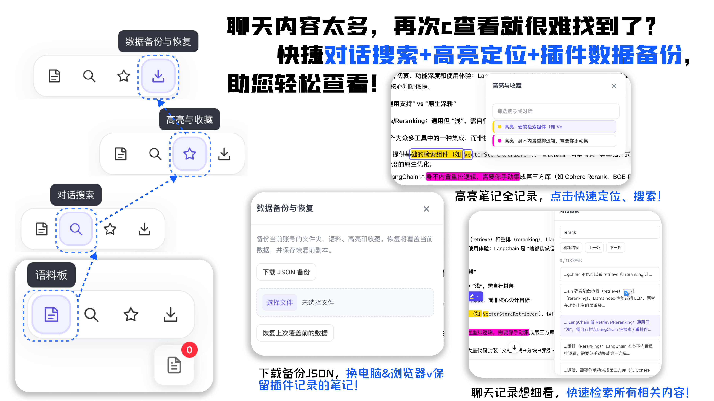
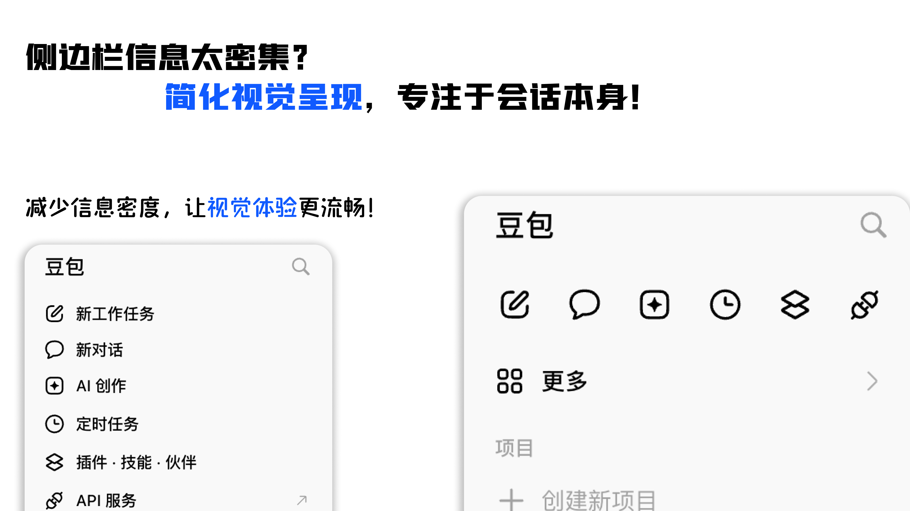
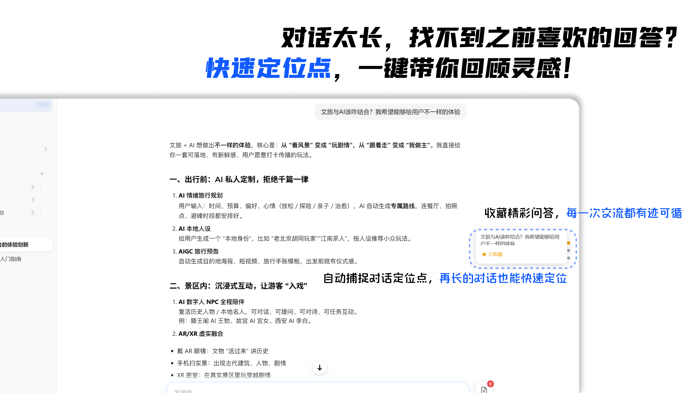
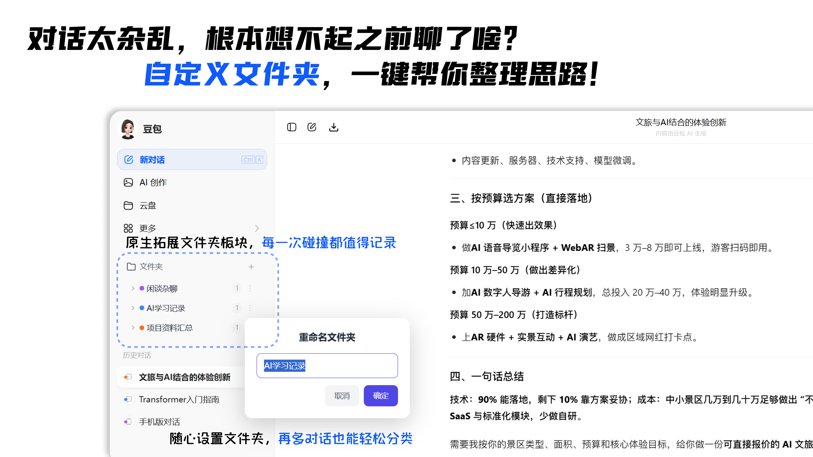
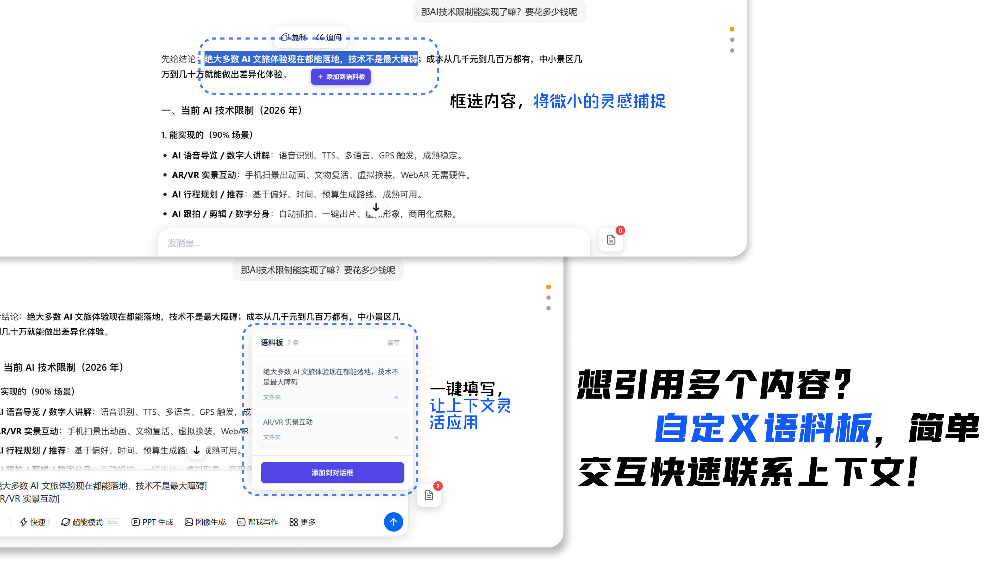
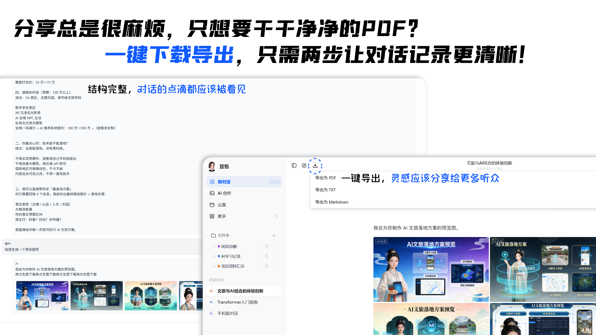
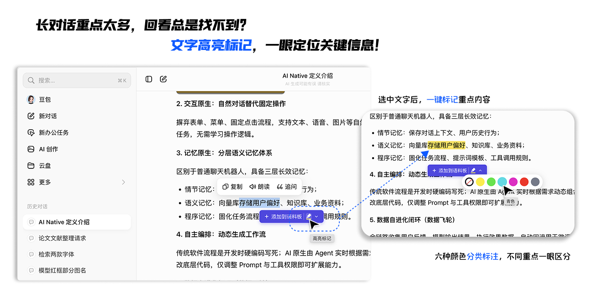

<div align="center">

# Better Doubao

**增强豆包网页版体验的开源浏览器扩展 · 可视化布局与主题定制 · 分类文件夹与极简圆点 · 悬浮快捷胶囊 · 原生点赞定位标星 · 多色高亮 · 语料板 · 多格式导出**

[](https://github.com/Rex16200513/Better_Doubao/actions/workflows/ci.yml)
[](https://github.com/Rex16200513/Better_Doubao/releases/latest)
[](https://microsoftedge.microsoft.com/addons/detail/better-doubao/ehkiambnigofgjbodfabknebbmlkblpd?hl=zh-CN)
[](chrome/manifest.json)
[](tsconfig.json)
[](LICENSE)

[下载安装包](#安装使用) · [Edge 插件商店](https://microsoftedge.microsoft.com/addons/detail/better-doubao/ehkiambnigofgjbodfabknebbmlkblpd?hl=zh-CN) · [2.2.0 更新说明](#220-版本更新) · [问题反馈](https://github.com/Rex16200513/Better_Doubao/issues/new/choose)

</div>

> 🔥 灵感来源于 [gemini-voyage](https://github.com/Nagi-ovo/gemini-voyager)，感谢作者的开源贡献！

## 📢 现已在微软商店成功上线！

**Better Doubao** 已正式在 Microsoft Edge 插件商店上线！您可以直接在商店中搜索并安装插件。

👉 [立即访问 Microsoft Edge 插件商店](https://microsoftedge.microsoft.com/addons/detail/better-doubao/ehkiambnigofgjbodfabknebbmlkblpd?hl=zh-CN)

---

## 功能概述

## 2.2.0 版本更新

2.2.0 围绕 **「所见即所得的界面定制、原生态无缝融合、极简视觉重塑」** 带来一次全面升级：

| 模块 | 核心升级亮点 |
| --- | --- |
| 🎨 **可视化布局与配色工作室** | 点击 Better Doubao 工具栏 **⚙** 打开豆包原型图弹窗，直接在示意图上点选开关侧边栏收纳、分类文件夹、顶栏导出/下载推广、底栏技能按钮、定位点点赞标星；内置 **6 套全局配色主题**（默认纯净 / 靛蓝极客 / 翡翠森系 / 暖纸护眼 / 暮光微紫 / 深邃暗夜），直连豆包原生 CSS 设计令牌，画布、欢迎语动画遮罩、圆角输入框与浮层全界面无死角变色。 |
| 💊 **悬浮快捷指令胶囊栏** | 在输入框正上方严格左对齐悬浮展示个性化指令胶囊，一键将常用 Prompt 填入输入框；最多横向平铺 5 个，超出部分自动收纳进 **`+N 更多 ▾`** 向上弹出菜单，不遮挡原生「更多技能」抽屉。 |
| 🗂️ **分类文件夹 & 极简色彩圆点** | 自动隐藏「最近」列表中杂乱的原生拟物对话图标，替换为 **8px 极简分类圆点**；点击任意对话前圆点即可弹出快捷浮层一键归类/改色/新建文件夹，并保留侧边栏彩色「分类文件夹」拖拽整理能力（完全兼容历史分类与备份数据）。 |
| 👍 **原生点赞联动快速定位点** | 顺应豆包已推出官方左侧快速定位，将旧版独立定位轨归档至 `archive/QuickLocator.legacy.ts`；现在只需点击消息底部的豆包原生 **「赞 👍」**，即可自动在左侧原生定位点对应刻度条上高亮琥珀金标记并同步写入收藏目录（兼容多轮懒加载对话）。 |
| ✨ **侧边栏「更多」双列抽屉** | 顶部快捷图标栏新增「工作台」收纳并将「更多 / 收起」固定在最右侧槽位；展开「更多」时不再顶乱图标顺序，改为在下方平滑展开双列小抽屉承接「AI 创作 / 资料库 / API 服务」等入口。 |
| 📄 **统一毛玻璃面板 & PDF 导出修复** | 语料板、对话搜索、高亮与收藏、数据备份四个浮层统一为 `316px` 毛玻璃卡片并统一 `Better Doubao` 品牌文案；彻底修复 PDF 导出出现异常长空白与 Markdown 表格样式丢失的问题。 |

---

## 2.1.0 版本更新

2.1.0 聚焦**深色模式、可定制开关、目录管理增强与安全稳定性加固**：

- **深色模式适配**：全套浮层、侧边栏、定位条与设置页统一采用 CSS 主题变量，自动响应系统与豆包页面深色主题。
- **扩展设置页功能开关**：在扩展设置页支持按需启停 7 项功能（含长对话自动全量索引开关），并支持一键恢复默认。
- **高亮与收藏目录升级**：新增 6 色高亮快捷筛选、列表内直接删除高亮 / 取消收藏（实时同步页面 DOM），收藏条目支持展示消息摘要。
- **快速定位器升级**：滚动阅读时实时高亮当前位置定位点；手动滚动可随时中止长对话自动扫描，不再抢夺滚动条。
- **非阻塞交互与安全修复**：全面替换原生 `alert` / `confirm` 为轻量 Toast 与确认弹窗；修复 PDF 导出安全清洗、相对图片 URL、Markdown 表格与图片重复、LaTeX 异步属性跳过、语料板清空隔离及账号存储键稳定性，并补齐单元测试与自动化 CI/Release 流水线。

**2.1.0 已发布**：[下载 Chrome / Edge 安装包](https://github.com/Rex16200513/Better_Doubao/releases/tag/v2.1.0)。商店版本以实际审核发布为准。

## 2.0 版本更新

2.0 围绕「快速找到内容、回看重点、保留插件笔记」升级了悬浮工具，同时保留原有导出与定位入口。



- **统一工具入口**：点击悬浮按钮展开语料板、对话搜索、高亮与收藏、数据备份四个等尺寸图标；悬停显示功能名，首次使用提供引导。
- **搜索到具体文字**：显示命中位置附近的简短摘要，点击选中关键词并滚动到对应位置，支持上一处／下一处及 Enter／Shift+Enter。
- **按颜色回看重点**：集中筛选高亮与收藏，高亮条目显示原标记颜色；点击定位到对应高亮文字，原文未加载时会提示。
- **可拖动的轻量面板**：统一标题、关闭按钮与样式，拖动标题栏调整位置；长列表滚动时标题栏固定，支持 Esc 关闭。
- **备份与恢复插件数据**：下载 JSON 文件，保存当前账号的文件夹、对话归类、语料、高亮和收藏。导入前校验并预览数量、确认覆盖，同时保留恢复前副本供回退。适用于换电脑、换浏览器或重装插件。
- **稳定性与数据保护**：增加导出备用入口，修复删除弹窗关闭，避免账号标记变化清空数据；新备份存入扩展私有存储，并增加构建资源完整性检查。

搜索仅覆盖页面已加载的内容，不代表完整历史检索。JSON 备份不包含豆包完整聊天记录、图片或附件，也不能恢复已删除的豆包对话；导入上限为 10 MB，文件可能包含私人摘录，请妥善保管。

**2.0.0 已发布**：[下载 Chrome / Edge 安装包](https://github.com/Rex16200513/Better_Doubao/releases/tag/v2.0)。商店版本以实际审核发布为准。

---

### 更清爽的侧边栏

新版将「新工作任务 / 新对话 / 工作台 / 定时任务 / 插件·技能·伙伴」收纳为固定横排图标，并将「更多 / 收起」固定在最右侧；展开「更多」时平滑展开紧凑双列小抽屉承接「AI 创作 / 资料库 / API 服务」，不破坏侧边栏排版。悬停或键盘聚焦图标即可在顶层浮窗查看完整名称，点击仍直达豆包原生功能。



### 1. 原生快速定位增强 (Native Locator Enhancer)

顺应豆包官方推出的左侧快速定位点，Better Doubao 2.2.0 起不再重复绘制独立定位轨（旧版独立定位器代码已归档至 `archive/QuickLocator.legacy.ts`），改为轻量增强原生定位点：

**功能特点：**
- 监听豆包消息底部的原生 **「赞 👍」** 按钮点击（自动区分「赞」与「踩」）
- 自动在左侧豆包原生定位点的对应刻度条上高亮琥珀金标记
- 同步记录消息摘要至 Better Doubao「高亮与收藏」目录，跨对话可回看与管理
- 基于原生当前高亮刻度锚点自动校准，多轮按需加载的长对话也能准确落点



---

### 2. 分类文件夹与极简色彩圆点 (Folder Manager)

用现代极简色彩体系整理对话列表，告别杂乱的原生对话图标：

**功能特点：**
- 自动替换「最近」列表中每条对话前的原生拟物图标为 **8px 极简分类圆点**（未分类为淡灰空心圆环，已分类显示对应文件夹主题色圆点）
- **点击圆点一键归类**：无需拖拽即可弹出快捷浮层，勾选加入/移出分类或即时新建分类
- 侧边栏「分类文件夹」支持 8 色标签、重命名、改色、折叠与拖拽整理
- 100% 兼容旧版本地文件夹与 JSON 备份数据



---

### 3. 语料板 (Corpus Board)

跨对话收集和复用文本片段。

**功能特点：**
- 页面右侧拖拽工具按钮
- 选中文本后显示添加按钮
- 语料持久化存储
- 一键将语料插入输入框（用 `[]` 包围）

**使用方式：**
- 拖拽工具按钮到合适位置
- 选中文本点击「添加到语料板」
- 点击语料板中的项目插入输入框



---

### 4. 导出功能 (Export)

将对话内容导出为多种格式。

**功能特点：**
- 支持 PDF、TXT、Markdown 三种格式
- 正确区分用户/AI 消息
- 支持图片导出（过滤 base64 占位图）
- Markdown 格式完整保留代码块、表格、加粗等样式
- 使用对话标题命名导出文件
- 与豆包原生界面风格一致

**使用方式：**
- 点击顶部导航栏导出按钮
- 选择导出格式
- 自动下载或打开打印预览



---

### 5. LaTeX 公式下载 (LaTeX Downloader)

快速下载或复制页面中的 LaTeX 数学公式。

**功能特点：**
- 自动识别页面中的 LaTeX 公式
- 支持内联公式和块级公式
- 支持 LaTeX 代码块
- 一键下载为 .tex 文件
- 一键复制到剪贴板

**使用方式：**
- 鼠标悬停在公式上，显示下载和复制按钮
- 点击下载按钮下载完整的 .tex 文档
- 点击复制按钮直接复制 LaTeX 代码


---

### 6. 文字高亮标记 (Text Highlight)

在长对话中标记重点内容，方便后续回看和快速定位关键信息。

**功能特点：**
- 选中文本后一键高亮，默认使用荧光黄标记
- 支持黄、绿、青、粉、红、灰六种高亮颜色
- 支持修改已高亮文字的颜色
- 支持取消选中文字的高亮，不影响同一段中的其他标记
- 高亮记录本地持久化保存，不涉及后端
- 切换对话、刷新页面或重新打开浏览器后，高亮仍然保留
- 颜色选择菜单会根据窗口边缘自动调整位置，避免被遮挡

**使用方式：**
- 选中对话中的文字，弹出操作按钮
- 点击荧光笔图标，使用默认黄色高亮
- 点击右侧箭头展开颜色菜单，选择想要的标记颜色
- 选中已高亮内容后，点击空心圆斜线图标取消高亮



---

### Better Doubao 工具栏使用说明

点击页面右侧悬浮触发按钮，展开五个统一图标：**语料板、对话搜索、高亮与收藏、界面布局与配色定制（⚙）、数据备份与恢复**。所有面板统一为 `316px` 毛玻璃卡片（原型图定制为居中大弹窗），悬停或键盘聚焦显示功能名，支持拖动与 Esc 关闭。

- **界面布局与配色定制（⚙）**：在豆包原型图上直接点击开关各区域显示状态，管理对话框上方悬浮快捷胶囊，并在 6 套全局主题间切换。
- **对话搜索**：按命中位置显示相关句子摘要，支持上一处、下一处、Enter / Shift+Enter 跳转并选中关键词；只搜索已加载内容，不保证覆盖虚拟列表中尚未加载的历史消息。
- **高亮与收藏**：集中查看保存的六色高亮摘录与点赞收藏位置，按颜色或关键词筛选，支持列表内直接删除。
- **数据备份与恢复**：下载当前账号的 JSON 数据；选择备份文件后预览数量并确认覆盖。恢复前会在扩展私有存储保存一份副本。文件上限 10 MB，备份包含聊天摘录，请自行妥善保管。

豆包页面改版可能影响功能；如遇定位失败，请先加载原文并刷新搜索结果。

## 技术架构

### 项目结构

```text
better-doubao/
├── .github/
│   ├── workflows/
│   │   ├── ci.yml              # GitHub Actions CI（类型检查 / 测试 / 双端构建）
│   │   └── release.yml         # 自动打包并发布 Chrome / Edge Release ZIP
│   ├── ISSUE_TEMPLATE/         # Issue 表单模板
│   └── PULL_REQUEST_TEMPLATE.md
├── archive/
│   └── QuickLocator.legacy.ts  # 归档的旧版独立定位器代码
├── src/                        # 共享源代码
│   ├── core/                   # 核心模块
│   │   ├── services/
│   │   │   ├── StorageService.ts
│   │   │   ├── SettingsService.ts
│   │   │   └── PageLifecycle.ts
│   │   ├── types/
│   │   │   ├── folder.ts
│   │   │   └── settings.ts
│   │   ├── utils/
│   │   │   ├── dom.ts
│   │   │   └── ui.ts
│   │   └── index.ts
│   ├── features/               # 功能模块
│   │   ├── workspace/          # 可视化布局与配色工作室、快捷胶囊栏、底栏精简
│   │   ├── tools/              # Better Doubao 统一工具栏（搜索 / 目录 / 备份）
│   │   ├── sidebar/            # 侧边栏快捷入口收纳与「更多」双列抽屉
│   │   ├── folder/             # 分类文件夹与极简色彩圆点
│   │   ├── quicklocator/       # 原生点赞联动原生定位点标星
│   │   ├── corpusboard/        # 语料板与六色文字高亮引擎
│   │   ├── export/             # 多格式导出（PDF / TXT / Markdown）
│   │   └── latex/              # LaTeX 公式下载与复制
│   ├── pages/
│   │   ├── content/            # 内容脚本入口
│   │   ├── background/         # Background Service Worker
│   │   ├── popup/              # 扩展弹出页面
│   │   └── options/            # 扩展设置页面（功能开关）
│   └── assets/
│       └── styles/
│           └── content.css
├── tests/                      # 自动化测试与构建产物校验
│   ├── build-artifacts.mjs
│   ├── review-regressions.mjs
│   └── unit.mjs
├── chrome/                     # Chrome Manifest V3 配置与构建输出
├── edge/                       # Edge Manifest V3 配置与构建输出
└── package.json
```

### 技术栈

- **语言**: TypeScript (Strict Mode)
- **构建工具**: Vite + `@crxjs/vite-plugin`
- **浏览器 API**: Chrome / Edge Extension Manifest V3
- **存储**: `chrome.storage.local`（纯本地扩展私有存储，不上传数据）
- **样式**: 原生 CSS + CSS Variables（支持浅色 / 深色模式）
- **自动化检查**: GitHub Actions CI（Node 20 / 22 矩阵：`typecheck` + `test` + `build`）

---

## 安装使用

### 下载编译好的 v2.1.0 安装包（无需 Node.js）

按浏览器选择对应安装包，均包含 2.1.0 全部新功能与修复。

- [下载 Chrome 版 ZIP](https://github.com/Rex16200513/Better_Doubao/releases/download/v2.1.0/Better_Doubao_Chrome_v2.1.0.zip)
- [下载 Edge 版 ZIP](https://github.com/Rex16200513/Better_Doubao/releases/download/v2.1.0/Better_Doubao_Edge_v2.1.0.zip)

下载对应浏览器的 ZIP 并解压到一个固定文件夹。Chrome 打开 `chrome://extensions/`，Edge 打开 `edge://extensions/`；开启「开发者模式」，点击「加载已解压的扩展程序」，选择解压后包含 `manifest.json` 的文件夹。安装后请保留该文件夹，不要移动或删除。ZIP 是可直接加载的编译结果，不需要自行构建；它不是双击安装的 CRX 文件。

### 从源码安装

1. **安装依赖并构建**：

```bash
# 安装依赖
npm install

# 构建 Chrome 版本（保留 chrome 文件夹时使用）
npm run build:chrome

# 构建 Edge 版本（保留 edge 文件夹时使用）
npm run build:edge
```

2. **加载扩展**：

**Chrome 用户**：
1. 打开 `chrome://extensions/`
2. 开启「开发者模式」
3. 点击「加载已解压的扩展程序」
4. 选择 `chrome/dist` 目录

**Edge 用户**：
1. 打开 `edge://extensions/`
2. 开启「开发者模式」
3. 点击「加载已解压的扩展程序」
4. 选择 `edge/dist` 目录

---

## 开发命令

```bash
# 开发模式（监听文件变化）
npm run dev

# 分别监听 Chrome / Edge 构建
npm run dev:chrome
npm run dev:edge

# 类型检查
npm run typecheck

# 运行回归测试与单元测试
npm test

# 同时构建 Chrome 和 Edge 并校验构建产物完整性
npm run build
```

---

## 贡献与反馈

欢迎提交 [Issue](https://github.com/Rex16200513/Better_Doubao/issues/new/choose) 反馈问题或提出功能建议，也欢迎 Fork 仓库后提交 Pull Request（提交前请确保 `npm run typecheck && npm test && npm run build` 全部通过）。

## 许可证

本项目基于 [MIT License](LICENSE) 开源。
