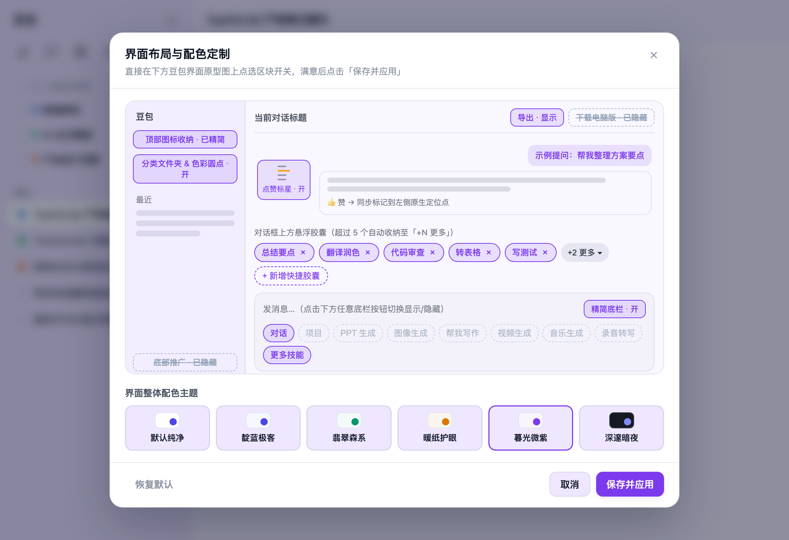

<div align="center">

# Better Doubao

**为豆包网页版打造的开源效率与美学增强扩展**

可视化布局与 6 套配色主题 · 悬浮快捷指令胶囊 · 分类文件夹与极简圆点 · 原生点赞定位标星 · 多色高亮 · 语料板 · 多格式导出

[](https://github.com/Rex16200513/Better_Doubao/actions/workflows/ci.yml)
[](https://github.com/Rex16200513/Better_Doubao/releases/latest)
[](https://microsoftedge.microsoft.com/addons/detail/better-doubao/ehkiambnigofgjbodfabknebbmlkblpd?hl=zh-CN)
[](chrome/manifest.json)
[](tsconfig.json)
[](LICENSE)

[核心亮点](#v220-核心亮点) · [功能演示](#完整功能一览) · [安装使用](#安装使用) · [更新日志](#更新日志) · [问题反馈](https://github.com/Rex16200513/Better_Doubao/issues/new/choose)

</div>

> 💡 灵感来源于 [gemini-voyager](https://github.com/Nagi-ovo/gemini-voyager)，感谢原作者的开源启发。
> 📢 已上线 **Microsoft Edge 插件商店**：[立即前往安装](https://microsoftedge.microsoft.com/addons/detail/better-doubao/ehkiambnigofgjbodfabknebbmlkblpd?hl=zh-CN)（最新 `v2.2.0` 可直接从 [GitHub Releases](https://github.com/Rex16200513/Better_Doubao/releases/tag/v2.2.0) 抢先体验）。

---

## v2.2.0 核心亮点

Better Doubao `v2.2.0` 围绕 **「所见即所得定制、原生态无缝融合、极简视觉重塑」** 全面升级：


| 模块 | 升级亮点 |
| --- | --- |
| 🎨 **可视化布局与配色工作室** | 点击工具栏 **⚙** 打开豆包原型图弹窗，直接在示意图上点选开关各区域元素；内置 **6 套全局配色主题**，直连豆包原生 CSS 设计令牌，画布、欢迎语遮罩、圆角输入框与浮层全界面无死角同步变色。 |
| 💊 **悬浮快捷指令胶囊栏** | 自定义常用 Prompt 胶囊严格左对齐悬浮在输入框正上方，一键填入；最多横向展示 5 个，超出自动收纳至 **`+N 更多 ▾`** 向上弹出菜单。 |
| 🗂️ **分类文件夹 & 极简色彩圆点** | 隐藏「最近」列表中杂乱的原生对话图标，替换为 **8px 极简分类圆点**；点击圆点一键归类/改色/新建分类，同时支持侧边栏彩色文件夹拖拽整理。 |
| ✨ **侧边栏「更多」双列抽屉** | 顶部固定主图标栏收纳常用入口，「更多 / 收起」固定在最右侧，展开时下方平滑弹出双列小抽屉承接「AI 创作 / 资料库 / API 服务」，不顶乱排版。 |
| 👍 **原生点赞联动定位点标星** | 点击消息底部的豆包原生 **「赞 👍」**，自动高亮左侧原生快速定位点刻度并同步记录至「高亮与收藏」目录（兼容多轮懒加载历史）。 |
| 📄 **毛玻璃统一面板 & PDF 导出修复** | 统一所有悬浮工具面板为 `316px` 毛玻璃卡片；修复 PDF 导出长空白与 Markdown 表格样式丢失问题。 |

---

## 完整功能一览

### 1. 可视化布局与 6 套全局配色主题（⚙）

点击右侧悬浮工具栏的 **⚙ 界面与按钮定制**，即可打开交互式豆包原型图弹窗：

- **原型图直点开关**：在示意图上直观控制「顶部图标收纳」「分类文件夹 & 色彩圆点」「侧边栏底部推广」「顶栏导出 / 下载电脑版」「点赞标星」「输入框精简底栏」及每个底栏原生技能按钮的显隐。
- **6 套全局配色主题**：内置 **默认纯净 / 靛蓝极客 / 翡翠森系 / 暖纸护眼 / 暮光微紫 / 深邃暗夜**，选中时原型图即时预览，保存后直连豆包底层 CSS 变量全界面生效。
- **悬浮快捷胶囊管理**：在原型图内直接增删常用指令胶囊，输入框上方自动左对齐展示并智能收纳多余按钮。



---

### 2. 侧边栏图标收纳抽屉 & 分类文件夹 / 极简圆点

告别信息过载的侧边栏与杂乱的原生对话图标：

- **顶部主图标栏 + 双列「更多」抽屉**：将「新工作任务 / 新对话 / 工作台 / 定时任务 / 插件·技能·伙伴」收纳为紧凑横排图标，悬停显示顶层提示；点击最右侧「更多」平滑展开双列小抽屉，收起后瞬间还原。
- **8px 极简分类圆点**：自动替换「最近」列表中每条对话左侧的原生拟物图标；未分类呈淡灰空心圆环，已分类呈现对应文件夹主题色圆点。
- **点击圆点一键归类 + 拖拽整理**：轻点任意对话前的圆点即可弹出「设置会话分类」浮层，一键勾选加入/移出或新建彩色文件夹，也支持直接拖拽归类（100% 兼容历史文件夹与 JSON 备份数据）。


---

### 3. 原生点赞联动快速定位点

顺应豆包官方推出的左侧快速定位轨，Better Doubao `v2.2.0` 不再重复绘制侧边定位条（旧版独立定位器代码已归档至 `archive/QuickLocator.legacy.ts`），改为轻量增强原生定位点：

- 点击 AI 回复底部的豆包原生 **「赞 👍」**（自动排除「踩」与其他按钮），立即在左侧原生定位点的对应刻度条上高亮琥珀金标记；
- 自动提取提问摘要并写入 Better Doubao「高亮与收藏」目录，支持跨对话检索与一键取消；
- 基于豆包当前黑色激活刻度作为锚点校准索引，长对话懒加载历史时同样准确落点。

---

### 4. 统一工具栏：语料板 · 对话搜索 · 六色高亮 · 数据备份

点击页面右下角可拖动的悬浮触发按钮，展开 5 个统一图标（**语料板 / 对话搜索 / 高亮与收藏 / 界面布局与配色定制 / 数据备份与恢复**），全部采用统一 `316px` 毛玻璃可拖动面板并支持 `Esc` 关闭：

- **语料板**：划词收藏高频片段，跨对话随时勾选并一键插入输入框。
- **对话搜索**：在当前已加载对话中实时检索关键词，展示上下文摘要，支持 `Enter` / `Shift+Enter` 上下跳转并选中命中词。
- **六色文字高亮与收藏目录**：划词一键荧光高亮（黄 / 绿 / 青 / 粉 / 红 / 灰），支持按颜色筛选、列表内直删与跨对话定位。
- **本地 JSON 备份与恢复**：一键导出当前账号的全部文件夹、归类、语料、高亮与收藏（上限 10 MB）；导入前自动校验与数量预览，并在私有存储保留恢复前副本以便回退。


---

### 5. 多格式对话导出 & LaTeX 公式下载

- **多格式清爽导出**：在顶部导航栏提供 **PDF / TXT / Markdown** 导出入口，自动按对话标题命名，清洗多余空白容器并完整保留表格、代码块与图片（自动过滤无效 base64 占位图）。
- **LaTeX 数学公式工具**：自动识别页面内联公式、块级公式与 LaTeX 代码块，悬停一键复制源码或下载 `.tex` 文件。


---

## 安装使用

### 方式一：Microsoft Edge 插件商店（推荐）

直接前往 [Microsoft Edge 插件商店](https://microsoftedge.microsoft.com/addons/detail/better-doubao/ehkiambnigofgjbodfabknebbmlkblpd?hl=zh-CN) 搜索 **Better Doubao** 一键安装（商店审核更新可能略晚于 GitHub Releases）。

### 方式二：下载编译好的 v2.2.0 安装包（无需 Node.js）

- **Chrome 用户**：[下载 Better_Doubao_Chrome_v2.2.0.zip](https://github.com/Rex16200513/Better_Doubao/releases/download/v2.2.0/Better_Doubao_Chrome_v2.2.0.zip)
- **Edge 用户**：[下载 Better_Doubao_Edge_v2.2.0.zip](https://github.com/Rex16200513/Better_Doubao/releases/download/v2.2.0/Better_Doubao_Edge_v2.2.0.zip)
- **校验文件**：[SHA256SUMS_v2.2.0.txt](https://github.com/Rex16200513/Better_Doubao/releases/download/v2.2.0/SHA256SUMS_v2.2.0.txt)

> **安装步骤**：将 ZIP 解压到固定目录 → 打开 `chrome://extensions/` 或 `edge://extensions/` → 开启右上角「开发者模式」→ 点击「加载已解压的扩展程序」→ 选择解压后包含 `manifest.json` 的文件夹（安装后请保留该目录）。

### 方式三：从源码构建

```bash
npm install
npm run build        # 同时构建 Chrome (chrome/dist) 与 Edge (edge/dist) 并校验产物完整性
```

开发调试命令：

```bash
npm run dev:chrome   # 监听 Chrome 端实时构建
npm run dev:edge     # 监听 Edge 端实时构建
npm run typecheck    # TypeScript 严格模式类型检查
npm test             # 运行回归测试与单元测试
```

---

## 技术架构

- **技术栈**：TypeScript (Strict Mode) · Vite + `@crxjs/vite-plugin` · Chrome / Edge Manifest V3 · 原生 CSS Variables
- **隐私安全**：所有设置、文件夹、语料、高亮与收藏仅保存在浏览器扩展本地私有存储（`chrome.storage.local`），按账号隔离，**零后端、不上传任何数据**。
- **质量保障**：GitHub Actions CI（Node 20 / 22 矩阵：`typecheck` + `test` + `build`）与 Tag 自动打包发布流水线。

<details>
<summary>查看完整项目目录结构</summary>

```text
better-doubao/
├── .github/
│   ├── workflows/
│   │   ├── ci.yml              # CI：类型检查 / 单测 / 双端构建校验
│   │   └── release.yml         # 自动打包并发布 Chrome / Edge ZIP 与校验和
│   ├── ISSUE_TEMPLATE/
│   └── PULL_REQUEST_TEMPLATE.md
├── archive/
│   └── QuickLocator.legacy.ts  # 归档的旧版独立定位器
├── src/
│   ├── core/
│   │   ├── services/           # StorageService / SettingsService / PageLifecycle
│   │   ├── types/              # folder.ts / settings.ts
│   │   └── utils/              # dom.ts / ui.ts（Toast / 确认弹窗）
│   ├── features/
│   │   ├── workspace/          # LayoutStudioModal（原型图定制）/ WorkspaceCustomizer（主题与胶囊）
│   │   ├── sidebar/            # SidebarLauncher（顶部图标栏与双列「更多」抽屉）
│   │   ├── folder/             # FolderManager（分类文件夹与 8px 色彩圆点）
│   │   ├── quicklocator/       # NativeLocatorEnhancer（原生点赞同步定位点标星）
│   │   ├── tools/              # ToolHub（统一工具栏：搜索 / 高亮目录 / 备份）
│   │   ├── corpusboard/        # CorpusBoard / TextHighlighter（语料板与六色高亮）
│   │   ├── export/             # ExportManager（PDF / TXT / Markdown 导出）
│   │   └── latex/              # LatexDownloader（LaTeX 公式复制与下载）
│   ├── pages/
│   │   ├── content/            # 内容脚本入口
│   │   ├── background/         # Manifest V3 Service Worker
│   │   ├── popup/              # 扩展弹窗页
│   │   └── options/            # 扩展功能开关设置页
│   └── assets/styles/
│       └── content.css
├── tests/                      # 回归测试、单元测试与构建产物校验
├── chrome/                     # Chrome Manifest V3 配置与构建输出
└── edge/                       # Edge Manifest V3 配置与构建输出
```

</details>

---

## 更新日志

### v2.2.0（最新）
- 新增可视化原型图 **界面布局与配色定制工作室（⚙）** 与 **6 套全局配色主题**（直连豆包原生 CSS 设计令牌）。
- 新增输入框上方 **悬浮快捷指令胶囊栏**（闭环左对齐，超 5 个自动收纳至 `+N 更多 ▾`）。
- 升级 **分类文件夹与 8px 极简色彩圆点**，替换原生对话图标，支持点击圆点一键归类与新建分类。
- 升级 **侧边栏「更多」双列抽屉**，展开不破坏顶部图标排列。
- 重构快速定位增强为 **原生点赞联动左侧定位点标星**，归档旧版独立定位器；统一毛玻璃工具面板并修复 PDF 导出空白与表格样式问题。
- 下载链接：[Release v2.2.0](https://github.com/Rex16200513/Better_Doubao/releases/tag/v2.2.0)

<details>
<summary>查看历史版本（v2.1.0 / v2.0.0）</summary>

#### v2.1.0
- 深色模式变量适配、扩展设置页功能开关、高亮 6 色筛选与列表内直删、非阻塞 Toast/确认弹窗、PDF 导出安全清洗与自动化 CI/Release 流水线。
- 下载链接：[Release v2.1.0](https://github.com/Rex16200513/Better_Doubao/releases/tag/v2.1.0)

#### v2.0.0
- 推出统一悬浮工具栏（语料板、对话搜索、高亮与收藏目录、JSON 备份与恢复）、可拖动轻量面板与侧边栏入口收纳。
- 下载链接：[Release v2.0](https://github.com/Rex16200513/Better_Doubao/releases/tag/v2.0)

</details>

---

## 贡献与许可证

欢迎提交 [Issue](https://github.com/Rex16200513/Better_Doubao/issues/new/choose) 反馈问题或建议，也欢迎 Fork 后提交 Pull Request（提交前请确保 `npm run typecheck && npm test && npm run build` 全部通过）。

本项目基于 [MIT License](LICENSE) 开源。
